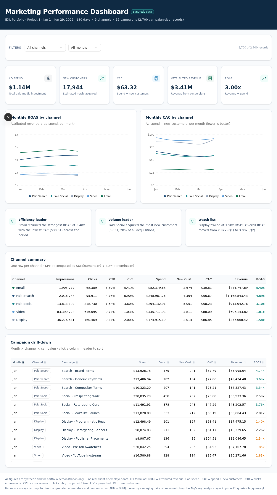

# Marketing Performance Dashboard — EXL Portfolio Project 1

**Live demo:** _paste your Vercel URL here after deploying — e.g. `https://marketing-performance-dashboard.vercel.app`_



An end-to-end marketing analytics portfolio project built on **2,700 synthetic campaign-day records**:

- **SQL analysis layer** — BigQuery Standard SQL queries for data QA, channel KPI summary, monthly trends, and campaign drill-down.
- **Interactive dashboard** — Next.js + shadcn/ui + Recharts: KPI cards, monthly ROAS/CAC trends by channel, filterable and sortable campaign table.
- **Written business interpretation** — what the numbers say and where budget should shift.
- **Reproducible synthetic data** — deterministic generator (seed = 42) with realistic paid-media patterns.

> All data in this repository is **synthetic** (fictional) and safe to publish. No real client or employer data is used anywhere.

## Repository layout

```
├── src/                          # Next.js 16 dashboard app (App Router)
│   ├── app/page.tsx              #   server component: loads the CSV, renders dashboard
│   ├── components/dashboard.tsx  #   KPIs, trend charts, filters, sortable tables
│   └── lib/dashboard-data.ts     #   types, aggregation (SUM/SUM ratios), formatters
├── public/data/
│   └── marketing_campaign_daily.csv   # 2,700 rows — also downloadable from the live site
├── analysis/
│   ├── project1_queries_bigquery.sql  # BigQuery analysis layer (QA, channel, monthly, drill-down)
│   ├── DATA_DICTIONARY.md             # field definitions + KPI formulas
│   ├── business_interpretation.md     # written analysis & recommendations
│   ├── dashboard_screenshot.png
│   └── query_results/                 # pre-computed query outputs (ready for Tableau Public)
├── scripts/
│   ├── generate_campaign_data.py      # synthetic data generator (seed = 42)
│   └── run_queries.py                 # pandas emulation of the SQL, writes query_results/
└── README.md
```

## Run the dashboard locally

```bash
npm install     # or: bun install
npm run dev     # then open http://localhost:3000
```

## Reproduce the analysis in BigQuery Sandbox

1. Create a dataset `marketing_analytics` (any consistent location).
2. Upload `public/data/marketing_campaign_daily.csv` as table `campaign_daily` with schema:
   `report_date` DATE · `impressions`, `clicks`, `leads`, `conversions`, `new_customers` INTEGER · `spend_usd`, `revenue_usd`, `projected_12m_ltv_usd` NUMERIC · `channel`, `campaign` STRING.
3. In `analysis/project1_queries_bigquery.sql`, replace `YOUR_PROJECT_ID` with your project ID and run the four queries.
4. Expected QA results: **row count 2,700 · dates 2025-01-01 → 2025-06-29 · 5 channels · 15 campaigns**.

Or regenerate everything locally: `python scripts/run_queries.py` (requires `pandas`).

## KPI definitions

| KPI | Formula |
|---|---|
| CTR | total clicks ÷ total impressions |
| CVR | total conversions ÷ total clicks |
| CAC | total ad spend ÷ total new customers |
| ROAS | attributed revenue ÷ ad spend |
| Avg. projected 12-mo LTV | projected LTV total ÷ new customers |
| Projected LTV-to-spend | projected LTV total ÷ ad spend |

Ratios are always recomputed from aggregated numerators and denominators (`SUM ÷ SUM`), never by averaging daily ratios.

## Headline results (full period)

| Channel | Spend | ROAS | CAC |
|---|---:|---:|---:|
| Email | $82,380 | **5.40x** | **$30.81** |
| Paid Search | $248,988 | 4.69x | $56.67 |
| Paid Social | $294,133 | 3.10x | $58.23 |
| Video | $335,718 | 1.81x | $88.09 |
| Display | $174,915 | 1.58x | $86.85 |

See `analysis/business_interpretation.md` for the full story and recommendations.

## Deploy your own copy (Vercel, free)

1. Push this repository to GitHub (see publishing steps below or in the project write-up).
2. Go to [vercel.com](https://vercel.com) → sign in with GitHub → **Add New… → Project**.
3. Import the repository — Vercel auto-detects Next.js. Click **Deploy**.
4. Share your live URL (`https://<repo-name>.vercel.app`) and add it to this README.

## Tableau Public alternative

Tableau Public publishes extracts, not live SQL connections. Build the dashboard from the pre-computed CSVs in `analysis/query_results/`, or connect directly to `marketing_campaign_daily.csv` and recreate the aggregations as Tableau views (using LOD expressions for `SUM(numerator)/SUM(denominator)` KPIs), keeping the SQL file as the documented analysis layer.
